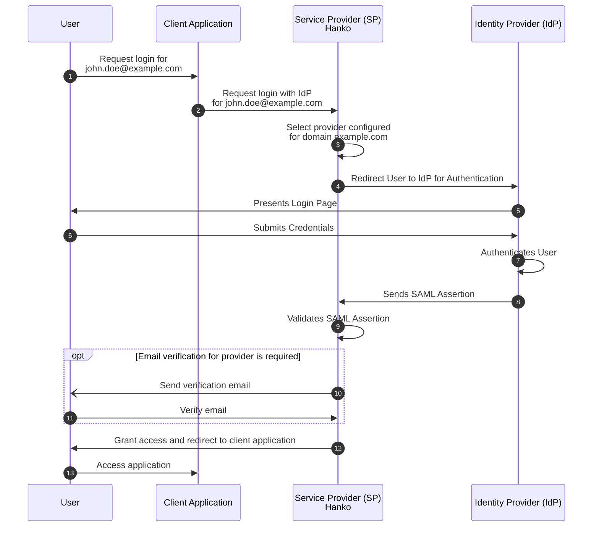
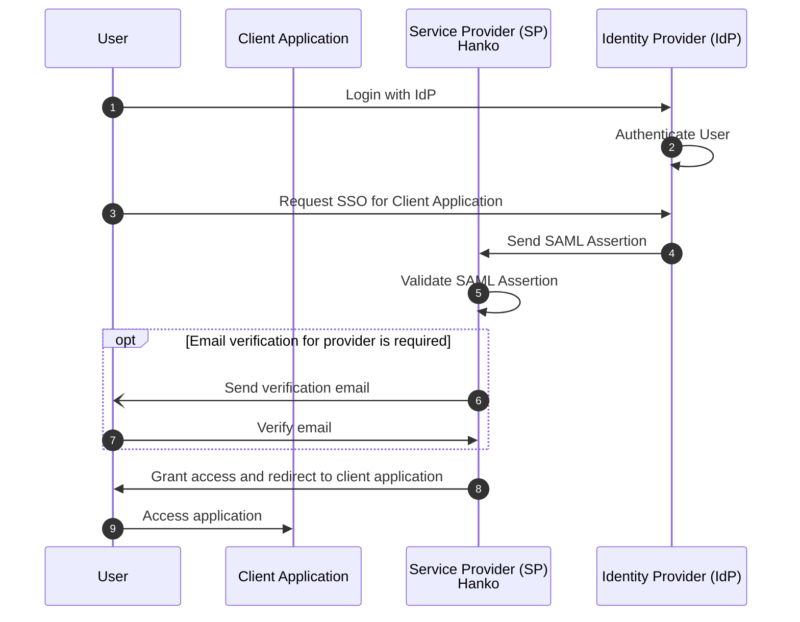

import HankoAbout from '/snippets/hanko-about.mdx'
import AccountProvisioning from '/snippets/account-provisioning.mdx'

<div class="hidden">
**Hanko SAML Integration Overview**:

**About Hanko**:
<HankoAbout />

**What This Guide Covers**: This guide provides a comprehensive overview of SAML SSO enterprise connections, including setup concepts, authentication flows, security considerations, and account provisioning strategies.

**Key Technologies**:
- SAML 2.0
- XML digital signatures
- Identity providers (IdP)
- Service providers (SP)
- SSO workflows

**Prerequisites**:
- Basic understanding of authentication concepts
- Hanko Cloud account
- Familiarity with identity provider terminology
- Understanding of enterprise authentication requirements

**Tasks You'll Complete**: 
- Understand SAML authentication flow types
- Learn enterprise connection configuration
- Explore SP-initiated vs IdP-initiated SSO flows
- Configure account provisioning and linking
- View and renew the SAML certificate of your project
- Review security considerations and limitations
- Access provider-specific integration guides
</div>

Security Assertion Markup Language (SAML) is an open standard for authentication and authorization that enables secure,
single sign-on (SSO) access to applications and services. By allowing identity providers (IdPs) to authenticate users
and pass authorization credentials to service providers (SPs), SAML enhances security, reduces password fatigue, and
improves user experience.

Hanko supports SAML SSO for any IdP compatible with the SAML 2.0 protocol.

<Info>
    This guide uses SAML 2.0 terminology. Consult the [glossary](#glossary) for unfamiliar terms.
</Info>

## Managing enterprise connections

A SAML SSO integration requires configuration at the Service Provider (SP, your Hanko project in this case) and
the Identity Provider (IdP).

### Adding an enterprise connection

To add an enterprise connection to your project:

1. Log in to [Hanko Cloud](https://cloud.hanko.io) and select your project.
2. Navigate to `Settings > Enterprise connections`.
3. Under `Connections`, click `New connection`.
4. In the shown modal provide the following data:
    -  A `Name` for the connection.
    -  A `Domain` for the connection. When users authenticate via SAML SSO, the domain of the email
       address provided as an identifier at the start of an authentication flow must match the domain configured here.
    -  A `Metadata URL`. This must be a URL pointing to a SAML 2.0 Metadata XML file containing the Identity Provider's
       metadata.
       <Warning>
           Hanko Cloud tenants currently do not support the upload of Metadata XML files. If your Identity Provider
           (IdP) does not offer a Metadata URL (e.g., Google) and instead only allows downloading a Metadata XML file,
           you must download this file, host it independently and publicly available, and provide the URL to the file.
       </Warning>
    -  Select whether you want skip email verification for this provider. If disabled, the Hanko tenant sends a
       verification email to the user's email address if no information about the verification status of a user's email
       address for the provider is discernible from SAML responses.
       <Warning>
           Hanko only treats a user's email as verified via this signal if you've mapped it: under `Attribute
           mapping`, set `Email verified` to the SAML attribute your IdP sends verification status under. Left
           unmapped, this stays unverified regardless of what your IdP actually sends - unless the connection's name
           contains "auth0", which defaults to Auth0's own verified-email attribute. It is therefore recommended to
           not skip email verification unless you've explicitly mapped this and trust the source, to prevent
           hijacking of existing Hanko accounts by bad actors using unverified IdP addresses (see also:
           [Account provisioning and linking](#account-provisioning-and-linking)).
       </Warning>

### Attribute mapping

By default, Hanko reads a fixed set of standard SAML attribute names to populate a user's profile. If your IdP
sends these under different names, see [Attribute mapping](/guides/user-data/attribute-mapping) to map them.

### SAML certificate

Hanko signs the sign-in requests it sends to your identity providers with the SAML certificate of your project and, if
an identity provider encrypts its responses, uses it to decrypt them. Identity providers use the certificate to verify
those requests and may use it to encrypt their responses. Give the metadata URL or the certificate to the
administrators of your identity providers (see [SAML data of Hanko Cloud projects](#saml-data-of-hanko-cloud-projects)).

#### Viewing the certificate

In the [Hanko Cloud Console](https://cloud.hanko.io), navigate to `Settings > Enterprise connections`. The
`Service provider certificate` section shows:

- The status of the certificate: `Valid`, `Expires soon` (it expires within 60 days) or `Expired`.
- The date the certificate expires on.
- The metadata URL of your project and a link to download the certificate (PEM).
- A hint if the name of the certificate no longer matches your API domain.

<Info>
    Older certificates can have a shorter validity than newer ones. Check the expiry date shown for your project.
</Info>

#### Creating a Java keystore

Some identity providers, for example Keycloak, do not accept a PEM file when you import the certificate of a client and
require a Java keystore (JKS or PKCS12) instead. To create one from the downloaded certificate, you can use `keytool`,
which is part of the Java Development Kit:

<Tabs>
<Tab title="JKS">
```bash
keytool -importcert -noprompt \
  -alias hanko-sp \
  -file <service-name>-service-provider.pem \
  -keystore hanko-sp.jks \
  -storetype JKS \
  -storepass changeit
```
</Tab>
<Tab title="PKCS12">
```bash
keytool -importcert -noprompt \
  -alias hanko-sp \
  -file <service-name>-service-provider.pem \
  -keystore hanko-sp.p12 \
  -storetype PKCS12 \
  -storepass changeit
```
</Tab>
</Tabs>

Replace `<service-name>-service-provider.pem` with the name of the downloaded file. If your identity provider asks
for the alias or the store password when you import the keystore, provide the ones from the command (`hanko-sp` and
`changeit`).

If the keystore file already exists in the folder you run the command in, for example after a renewal, delete it
first, or use a different alias. `keytool` does not overwrite an existing alias.

`keytool` requires a store password of at least six characters. The keystore only contains the public certificate
and no private key, so there is no key password and the store password does not protect a secret.

After you [renew the certificate](#renewing-the-certificate), delete the old keystore file, create the keystore again
from the new certificate and import it at your identity provider.

#### Renewing the certificate

To renew the certificate of your project:

1. Log in to [Hanko Cloud](https://cloud.hanko.io) and select your project.
2. Navigate to `Settings > Enterprise connections`.
3. In the `Service provider certificate` section, click `Renew certificate`.
4. _Optional_: Expand `Advanced options` to change how the certificate is renewed:
    -  `Key size`: Keep the current key, or choose a key size of 2048, 3072 or 4096 bit.
    -  `Validity`: How long the renewed certificate is valid for, from 1 to 10 years. The default is 10 years.
    -  `Generate a new key pair`: Generate a new key pair even if the key size stays the same.
5. Confirm and click `Renew certificate`.

The Entity ID, the ACS URL and the metadata URL of your project do not change when you renew the certificate.

By default, the key pair stays the same and only a new certificate is issued. Identity providers that stored the
previous certificate need the new one: some keep working because they only check the public key, others reject
sign-ins until they are updated. Give your identity providers the new certificate using the metadata URL or the link
to the certificate. If an identity provider requires a keystore file, delete the old one and
[create the keystore](#creating-a-java-keystore) again from the new certificate.

<Warning>
    Choosing another key size always generates a new key pair. With a new key pair, your identity providers no longer
    have the matching public key: until they have the new certificate, sign-ins through identity providers that
    encrypt their responses fail and signatures of sign-in requests may be rejected. Plan the renewal together with
    the administrators of your identity providers.
</Warning>

#### Certificate expiry

Hanko checks the validity of the certificate when it decrypts a response, so once the certificate has expired,
sign-ins through identity providers that encrypt their responses fail. Signing sign-in requests keeps working, but
whether an identity provider accepts requests signed with an expired certificate depends on the provider. Renew the
certificate before it expires.

#### Custom domains

When you set up or remove a [custom domain](/guides/custom-domain/custom-domain) for your project, the API URL of your
project changes, and with it the `Entity ID/Audience URI`, the `Assertion Consumer Service (ACS) URL` and the metadata
URL (see [SAML data of Hanko Cloud projects](#saml-data-of-hanko-cloud-projects)). Update them at your identity
providers. If sign-ins still fail after a change, you may also have to update the certificate or re-import the
metadata at the identity provider manually.

The certificate itself is not changed: it stays valid and keeps its key. Its common name and subject alternative name
are the host name of the API URL at the time the certificate was issued or renewed, so they still show the previous
host name, and the console shows a hint about it. Hanko does not check this name, but an identity provider may. If you
want the name to match your domain, or your identity provider requires it, you can
[renew the certificate](#renewing-the-certificate); identity providers that stored the previous certificate then need
the new one.

### Configuring SAML identity providers

The configuration required at an IdP varies by provider. While Hanko supports any SAML 2.0-compatible provider, the following providers have been officially tested:

- [Auth0](/guides/enterprise-sso/auth0)
- [Microsoft Entra ID](/guides/enterprise-sso/entra)
- [Google (Workspaces)](/guides/enterprise-sso/google)
- [Okta](/guides/enterprise-sso/okta)

## Using enterprise connections

Once you have set up a connection, users can authenticate via SAML SSO using either a
[Service Provider-initiated SSO](#service-provider-initiated-sso) or
an [Identity Provider-initiated SSO](#identity-provider-initiated-sso) flow.

The main difference between these two flow types is that in an SP-initiated SSO flow, the authentication process starts
when the user attempts to access a service, whereas in an IdP-initiated flow, the user begins the authentication process
at the IdP.

### Service provider-initiated SSO

The Service Provider-initiated (SP-initiated) flow begins with the Service Provider (SP - your Hanko Cloud tenant acting
as the Service Provider) initiating a SAML authentication request when attempting to access your client application,
rather than the user directly starting it with the IdP. It will automatically attempt to match the domain of a
user's email address provided as an identifier at the start of an authentication to the domain you configured for your
connection (see [Managing Enterprise Connections](#managing-enterprise-connections)) and then redirect to the IdP for
authentication.



1. The User requests access to your application and provides an email address as an identifier.
2. The authentication request is relayed to your Hanko Cloud tenant.
3. The Hanko API (which acts as a Service Provider (SP) in SAML terms) determines the Identity Provider (IdP) for the
   provided email address' domain.
4. The SP redirects the User to the IdP for authentication.
5. The IdP displays a login page to the User.
6. The User submits their credentials to the IdP.
7. The IdP authenticates the User.
8. Upon successful authentication, the IdP generates and sends a SAML Assertion back to the SP.
9. The SP validates the SAML Assertion.
10. _Optional_: If email verification for the provider is required, the SP sends a verification email to the User's
    email address.
11. _Optional_: The User verifies his email address.
12. Once validated and optional email verification was performed, the SP grants access and redirects the User to the
    Client Application.
13. The User accesses the Client Application.


### Identity provider-initiated SSO

In an Identity Provider-initiated (IdP-initiated) flow, the user begins at the Identity Provider (IdP), which could be
a login portal or a service like Google or Microsoft. After authentication with the IdP the user selects which service
or application they want to access.



1. The User accesses the IdP and requests a login.
2. The IdP authenticates the user.
3. The user requests access to a specific Client Application or Service.
4. The IdP generates and sends a SAML Assertion to the SP.
5. The SP validates the received SAML Assertion.
6. _Optional_: If email verification for the provider is required, the SP sends a verification email to the User's
email address.
7. _Optional_: The User verifies the email address.
8. Upon successful validation, the SP grants the user access to the requested service.
9. The User accesses the Client Application.

#### Security considerations

An IdP-initiated flow is inherently more insecure than an SP-initiated flow because it allows the IdP to send
SAML assertions directly to the SP (so-called _unsolicited_ SAML responses) without first verifying that the
user actually requested access to the SP. This increases the risk of unauthorized access if the IdP’s response is
intercepted or if there is a vulnerability in the IdP, as the SP has no prior context to ensure the user’s intent.

To mitigate the risks of IdP-initiated flows:

- Hanko ensures that unsolicited SAML responses do not contain an `InResponseTo` attribute (following section
  `4.1.5 Unsolicited Responses` of the
  [SAML 2.0 profiles specification](https://docs.oasis-open.org/security/saml/v2.0/saml-profiles-2.0-os.pdf)).
  This prevents malicious actors from intercepting a response used in an SP-initiated flow and reusing it in an
  IdP-initiated flow.
- To further mitigate the risk of replay of SAML responses, Hanko keeps track of all IdP-initiated SAML requests to
  ensure one-time use.

Because of the risks of the IdP-initiated it is recommended to use an SP-initiated flow instead.

## Account provisioning and linking

<AccountProvisioning />

## SAML data of Hanko Cloud projects

Below you will find configuration data of your project that may be required for integrating with an Identity Provider.

| Property                               | Value                                            |
|----------------------------------------|--------------------------------------------------|
| `Assertion Consumer Service (ACS) URL` | `<project_api_url>/saml/callback`                |
| `Entity ID/Audience URI`               | `<project_api_url>`                              |
| `Metadata URL (download)`              | `<project_api_url>/saml/metadata`                |
| `Metadata URL (certificate)`           | `<project_api_url>/saml/metadata?cert_only=true` |

Replace the `<project_api_url>` with your project's API URL. You can find the API URL
on your project's dashboard in the [Hanko Cloud Console](https://cloud.hanko.io).

The ACS URL (shown as `Redirect URL`), the Entity ID/Audience URI, the metadata URL and a link to the certificate are
also shown in the console under `Settings > Enterprise connections`, together with the status of the certificate (see
[SAML certificate](#saml-certificate)).

## Limitations

- **No subdomains**: When authenticating via SAML SSO the domain of a user's email address must exactly match the domain
configured for an enterprise connection. If you have configured a domain of `example.com` and a user attempts to
authenticate with an email address of `john.doe@subdomain.example.com` then no SAML SSO flow will be triggered but
instead the login flow will proceed using any of the authentication methods activated for your tenant.
- **Number of enterprise connections**: Every Hanko Cloud project includes one free enterprise connection.
Your organization will be charged an additional fee per month per connection. See [Pricing](https://www.hanko.io/pricing)
for more details.
- **Single Logout (SLO)**: Single Logout (SLO) is currently not supported.

## Glossary

import SamlGlossary from '/snippets/authentication-methods/saml/saml_glossary.mdx';

<SamlGlossary/>