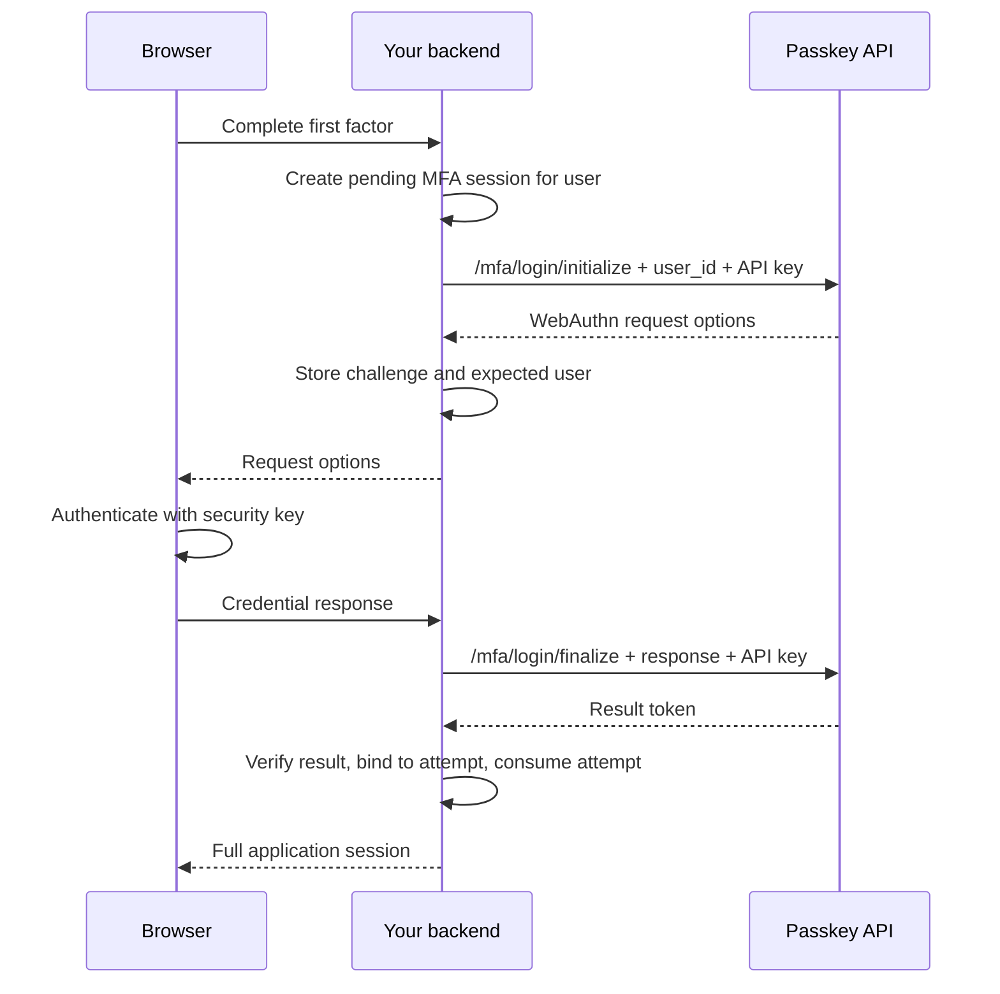

The Passkey API supports standalone passwordless login and WebAuthn as an additional factor. The `/mfa` routes are intended for applications that already authenticate the user with a first factor, such as a password, and then ask for a security key.

## Choose the routes

All paths below are relative to `/{tenant_id}`.

| Behavior | Normal routes | MFA routes |
| --- | --- | --- |
| Registration | `/registration/initialize` and `/registration/finalize` | `/mfa/registration/initialize` and `/mfa/registration/finalize` |
| Login | `/login/initialize` and `/login/finalize` | `/mfa/login/initialize` and `/mfa/login/finalize` |
| New credential's `is_mfa` | `false` | `true` |
| Credentials accepted for login | Only `is_mfa: false` | Both values of `is_mfa` |
| User identification at login initialization | Optional `user_id`; omitting it requires a discoverable credential | Required `user_id` |
| Secret API key | Required to initialize registration and to initialize login with `user_id`; other normal login calls and registration finalization are public | Required for all four endpoints |
| Authenticator settings | Tenant WebAuthn configuration | Separate tenant MFA configuration |

Both flows use the same tenant RP ID, allowed origins, and user accounts. MFA does not create a separate credential namespace. Normal transaction authentication also excludes credentials with `is_mfa: true`.

The API verifies the WebAuthn ceremony; it does **not** verify that a first factor has succeeded. Your backend must obtain the MFA user ID from trusted first-factor session state, bind the challenge and result to that user and pending login, and create a full application session only after both steps succeed. Follow [Login session binding](/passkey-api/login-session-binding).

For standalone login, verify and bind the WebAuthn result before creating the application session. Do not treat an MFA result as proof that the application completed both factors.

## Register a second-factor credential

Authorize enrollment from an authenticated application session. Obtain the user ID from that session, not from a browser-supplied user ID. All calls to the MFA endpoints below run on your backend with the secret API key.

1. Initialize registration for the authenticated user:

```http
POST /{tenant_id}/mfa/registration/initialize
apiKey: <secret API key>
Content-Type: application/json

{"user_id":"user-123","username":"alice@example.com"}
```

2. Store the returned `publicKey.challenge` against the enrollment session and expected user. Send the creation options to the browser.
3. The browser calls WebAuthn `create()` and returns the credential response to your backend. Match its challenge to the pending enrollment, then forward that same response unchanged to:

```http
POST /{tenant_id}/mfa/registration/finalize
apiKey: <secret API key>
Content-Type: application/json
```

The request body is the serialized credential response, including `id`, `rawId`, `type`, and `response`; it is not another user ID. Only mark enrollment successful after API verification and completing the matching pending operation. The API stores the credential with `is_mfa: true`. Do not expect a login `challenge` claim in the registration token.

## Complete a login with MFA



After your first-factor check succeeds, initialize MFA for the user in that pending session:

```http
POST /{tenant_id}/mfa/login/initialize
apiKey: <secret API key>
Content-Type: application/json

{"user_id":"user-123"}
```

Persist the returned challenge, intended operation, expected user, and expiration before sending the request options to the browser. The browser performs WebAuthn authentication and returns the assertion to your backend. Forward it unchanged as the JSON body of:

```http
POST /{tenant_id}/mfa/login/finalize
apiKey: <secret API key>
Content-Type: application/json
```

A successful response has the form `{ "token": "<signed JWT>" }`. Before granting full access, verify the result and bind it to the pending session and expected user using [Login session binding](/passkey-api/login-session-binding). Atomically consume the attempt and rotate the application session. The linked guide explains deployment requirements for the signed challenge claim and an alternative for older servers.

The browser ceremony is the same WebAuthn `create()`/`get()` interaction shown in [Register and sign in with passkeys](/passkey-api/example-implementation). The MFA endpoints, required user ID, API-key protection, and first-factor session are the important differences. For the equivalent SDK methods, see [JavaScript/TypeScript Backend SDK](/passkey-api/js-sdk#mfa).

## Authenticator settings

The following are the **current server application's creation defaults** when optional configuration fields are omitted. Existing tenant settings and explicit provisioning values take precedence; these are not a guarantee of the configuration of a hosted project.

| Setting | Normal registration/login | MFA registration/login |
| --- | --- | --- |
| `user_verification` | `required` | `preferred` |
| `resident_key_requirement` | `required` | `discouraged` |
| `attachment` | Unspecified: platform and cross-platform authenticators allowed | `cross-platform` |
| `attestation_preference` | `direct` | `direct` |

User verification applies to registration and authentication. Resident key, attachment, and attestation settings apply to registration; attachment is not a login-time hardware restriction. MFA initially inherits the configured WebAuthn timeout when its configuration is created automatically, and can have its own configured timeout. Both flows enforce their configured timeouts.

<Note>
There is a historical default discrepancy: the MFA database migration and test fixtures specify `user_verification: discouraged`, while the current configuration creation code and missing-configuration fallback use `preferred`. The normal WebAuthn database migration likewise specifies `preferred`, while current configuration creation uses `required`. Check the stored tenant configuration and generated WebAuthn options rather than inferring effective settings from database defaults.
</Note>

### User verification and security keys

User presence, such as touching a security key, is different from user verification using the authenticator's PIN or biometrics. `preferred` permits authentication without UV but may prompt for it. `discouraged` asks to avoid UV, without guaranteeing that the authenticator will omit it. `required` rejects authentication without UV.

For a security key used after a password, explicitly configuring MFA UV as `discouraged` can avoid an additional PIN prompt. This is a reasonable second-factor policy, but it is not the current application default. See [Yubico's guidance on user presence and verification](https://developers.yubico.com/WebAuthn/WebAuthn_Developer_Guide/User_Presence_vs_User_Verification.html).

### Discoverability and U2F compatibility

MFA already knows the user and supplies credential IDs through `allowCredentials`, so it does not need discoverability. `residentKey: discouraged` prefers non-discoverable credentials but still permits discoverable ones. It can also avoid consuming limited resident-credential slots on hardware keys.

This configuration supports compatibility with U2F/CTAP1 keys, which cannot provide discoverable credentials or UV: neither capability may be required. Actual support still depends on the browser, platform, and key. `preferred` UV also permits keys without UV; `discouraged` additionally requests avoiding the extra verification step on capable keys.

Supporting U2F hardware through WebAuthn is different from migrating credentials previously registered through the legacy U2F API. Do not assume those existing credentials can be reused: that requires a separate migration design, including AppID handling. See the [WebAuthn specification](https://www.w3.org/TR/webauthn-3/#enumdef-residentkeyrequirement) and [Yubico's U2F migration checklist](https://developers.yubico.com/WebAuthn/WebAuthn_Developer_Guide/WebAuthn_Readiness_Checklist.html).

## Change a credential's permitted usage

`is_mfa` is a server-side usage restriction, independent of UV support, discoverability, and synchronization. A credential registered through MFA may be non-discoverable and is not necessarily a passkey in the discoverable-credential sense.

Use [Update Credential](/passkey-api/reference/credentials/update-credential) from your backend to permit standalone login:

```http
PATCH /{tenant_id}/credentials/{credential_id}
apiKey: <secret API key>
Content-Type: application/json

{"is_mfa": false}
```

This administrative operation does not run a WebAuthn ceremony or prove possession or UV capability. Authorize an end-user request using a fresh, complete authentication. For secure standalone login, require UV in the normal login policy and keep that requirement in place. A key that cannot provide UV will not work under that policy.

Changing the flag does not make a credential discoverable. A non-discoverable credential still needs normal login initialized with `user_id` and a secret API key on your backend. Register a new credential if you need capabilities the existing credential cannot provide.

Set `is_mfa` to `true` to restrict the credential to MFA again. Ensure the user retains another standalone login or recovery method. Existing application sessions are not revoked.

The PATCH accepts `name`, `is_mfa`, or both. Omitted fields remain unchanged. Empty updates, empty names, and non-boolean flag values are rejected. Repeating the same flag value is supported.

When audit logging is enabled, `webauthn_credential_updated` includes `credential_id` and, when the flag was submitted, `old_is_mfa` and `new_is_mfa`. Equal values mean an idempotent request; name-only updates omit both flag fields. See [Audit logs](/passkey-api/reference/list-audit-logs). These PATCH and audit fields require the updated API release. Self-hosted deployments must apply migration `20261026120000_add_credential_audit_details` before running the updated server.
